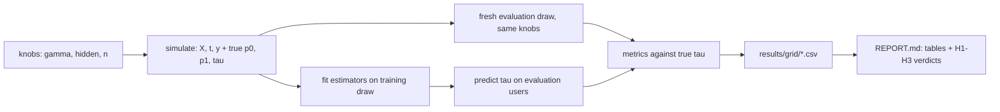

# Causal Uplift

> How far do uplift estimators fall from a known true treatment effect as confounding rises?

[](https://github.com/Prithv122/causal-uplift/actions/workflows/ci.yml)

**Live demo:** not deployed — a command-line experiment that runs locally
**Stack:** Python 3.12, numpy, pandas, scikit-learn, LightGBM; EconML as an optional reference arm

---

## 1. The problem

A retention team has a discount budget. Sending it to the users most likely to convert wastes
it on people who would have converted anyway; it should go to users whose conversion the offer
actually *changes*. That is a causal question, and the logs it has to be answered from are not
randomised: the team already sent more offers to engaged users, so a plain comparison of offered
and not-offered users mixes the offer's effect with who got it.

This repo measures how wrong the usual answers are. It simulates users whose true individual
effect is known exactly, then scores each estimator against that truth as the targeting bias
grows from none (a randomised test) to strong.

## 2. The data

| | |
|---|---|
| Source | Own simulator (`src/causal_uplift/dgp.py`), seeded, specified in `DESIGN.md` |
| Size | 10,000 training + 20,000 evaluation users per replication, 200 replications per setting |
| Licence | Code, MIT |
| Real-data check | Criteo Uplift (randomised, 13,979,592 rows, CC BY-NC-SA 4.0), downloaded by a command, never committed |

**The headline numbers are on synthetic data.** That is the point: only a simulation knows each
user's true effect, so only a simulation can say how far an estimate is from it. Real randomised
data has no per-user truth and gets an outcome-only Qini check.

Four planted segments: persuadables (the offer helps), sure things (they convert anyway), lost
causes (nothing helps) and sleeping dogs (the offer hurts).

## 3. Architecture



## 4. Key decisions & tradeoffs

| Decision | Chose | Over | Why |
|---|---|---|---|
| Ground truth | Own simulator with exact per-user `tau` | Only a real dataset | No real dataset has individual effects; without them PEHE and true-Qini cannot be computed |
| Learners | Own S/T/X/DR implementations on LightGBM | EconML as the primary arm | Every step is explainable and testable here; EconML's causal forest stays as a reference arm |
| Evaluation sample | Fresh draw of 20,000 users per replication | Scoring on the training users | Ranking metrics on training users reward overfitting |
| Ranking metric | Qini against the true effect, normalised by the oracle | Outcome-based Qini only | Under confounding the outcome-based Qini is itself biased |
| Reproducibility | `SeedSequence([seed, cell, rep])`, LightGBM single-threaded and deterministic | One global RNG | A row's numbers do not depend on worker count or run order |

## 5. Results

All numbers below are from `results/REPORT.md`: the pre-registered grid, **synthetic data**, 10
settings × 200 replications, each replication fitted on 10,000 simulated users, LightGBM base
learners. Ranking and policy metrics are scored on 20,000 fresh users; ATE bias and coverage are
measured against the true average effect of the 10,000 training users, the sample every ATE
estimator averages over. "Own SE" is the standard error the estimator reports for itself,
averaged over replications. Provenance and a reproduction check are in
`results/PROVENANCE.md`.

**Verdicts (mechanical, rules fixed in `PREREGISTRATION.md` before the run):**

| | Hypothesis | Verdict | Deciding numbers |
|---|---|---|---|
| H1 | X- and DR-learner rank users better than the response model when assignment is random | **supported** | Qini vs truth: X 0.877, DR 0.800, response 0.480; paired gaps +0.397 and +0.319, MC SE 0.0015 and 0.0016 |
| H2 | From gamma 0.5 the naive estimate is biased while IPW and AIPW stay usable | **not supported** | IPW fails at gamma 1.0: \|bias\| 0.0123 > own SE 0.0117, coverage 0.86. Every other condition holds |
| H3 | With hidden confounding, IPW and AIPW stay biased (expected failure) | **not supported** | 7 of 8 conditions hold; IPW at (gamma 0.5, hidden 0.5): \|bias\| 0.0168 < threshold 2 × own SE = 0.0199 |

**ATE bias under observed confounding (hidden = 0):**

| gamma | naive | IPW (LightGBM propensity) | IPW (logistic propensity)* | AIPW (DR) | coverage, IPW / AIPW |
|---|---|---|---|---|---|
| 0 | -0.0007 | -0.0006 | -0.0006 | -0.0009 | 0.980 / 0.970 |
| 0.5 | +0.0793 | -0.0074 | -0.0009 | -0.0011 | 0.915 / 0.930 |
| 1.0 | +0.1409 | -0.0123 | -0.0001 | -0.0007 | 0.860 / 0.980 |
| 2.0 | +0.2067 | -0.0176 | +0.0048 | -0.0006 | 0.920 / 0.950 |

The true ATE is about 0.079 (7.9 percentage points). \*Exploratory arm added before the run
(amendment A1, after a review pilot); no verdict reads it. MC SE of each mean bias is 0.0006 to
0.0013. IPW's SE treats the estimated propensity as known, so its intervals are conservative
(too wide); that makes its coverage easier to reach, not harder.

**Ranking (Qini against the true effect, 1 = oracle, 0 = random) and policy value:**

| gamma, hidden | response | S-learner | T-learner | X-learner | DR-learner |
|---|---|---|---|---|---|
| 0, 0 | 0.480 | 0.941 | 0.822 | 0.877 | 0.800 |
| 1.0, 0 | 0.481 | 0.933 | 0.806 | 0.859 | 0.732 |
| 2.0, 0 | 0.486 | 0.914 | 0.769 | 0.837 | 0.553 |
| 1.0, 1.0 | 0.490 | 0.817 | 0.723 | 0.784 | 0.671 |

Treating the top 20% at gamma 0 (incremental conversions per user, net of a cost of 0.02 per
treated user): oracle 0.0623, S-learner 0.0585, X-learner 0.0556, DR-learner 0.0514, response
model 0.0298, random 0.0117.

**What the numbers say:**

- **Uplift modelling paid.** Every learner ranked users far better than "treat who is most likely
  to convert", at every setting. The response model reached about half the oracle's ranking
  quality; its top 20% buys roughly half the conversions an S-learner's does.
- **The best ATE estimator was not the best ranker.** AIPW stayed within 0.0011 of the truth with
  0.925–0.98 coverage at every observed-confounding level, but the DR-learner's ranking fell from
  0.800 to 0.553 as confounding rose. The S-learner ranked best in every cell (0.914–0.942 with no hidden
  confounding).
- **IPW with a LightGBM propensity drifted; with a logistic one it did not.** With LightGBM its
  bias grew from -0.0074 to -0.0176, and it passed the "usable" rule at gamma 2 only because its
  own SE widened. The same weighting with a logistic propensity stayed within 0.005 at every
  hidden = 0 level. My reading is that the propensity model, not the weighting, is the cause, but
  the comparison is flattering to the logistic arm: with no hidden confounding the true
  propensity is `sigmoid(gamma * x0)`, exactly the logistic form. On real data neither model is
  known to be right.
- **Why H3 failed in one condition.** At (0.5, 0.5), AIPW and logistic IPW are biased by
  +0.0226 (coverage 0.31–0.32). LightGBM IPW shows +0.0168, close to +0.0226 plus the -0.0063
  gap between it and AIPW at gamma 0.5 with no hidden confounding (sum +0.0163). My reading,
  which the grid did not test directly, is that two errors offset each other rather than an
  adjustment working. With stronger hidden
  confounding every method was biased (+0.08 to +0.15 at hidden 1.0) and the CATE learners'
  rankings degraded too.
- **Breaking points (smallest gamma at which the ATE stops being usable):** naive at 0.1 (bias
  +0.0169, coverage 0.55), T-learner's averaged effect at 2.0 (+0.0169), LightGBM IPW at 1.0.
  AIPW, logistic IPW, and the S- and X-learner averages stayed usable across the whole grid.

**Causal-forest reference arm** (`results/forest/REPORT.md`; EconML `CausalForestDML`, 2 cells ×
20 replications, no hypothesis): true-effect Qini 0.920 at gamma 0 and 0.901 at gamma 1.0, against
0.879 / 0.861 for my X-learner and 0.803 / 0.741 for my DR-learner on the same draws; ATE bias
-0.0010 and -0.0026 (MC SE 0.0015 and 0.0026). It agrees with the own implementations in
direction and sits below the main grid's S-learner (0.941 / 0.933, different draws), at about 28 s per fit
against 3–4 s for the X- and DR-learner.

**Difference-in-differences** (`results/DID.md`; 2,000 units × 200 replications, true effect
0.05): with parallel trends, DiD bias is +0.0002 (coverage 0.96). A trend gap of 0.01 / 0.03 /
0.05 shows up as bias of +0.0104 / +0.0299 / +0.0500, so coverage falls to 0.615 / 0.015 /
0.000. The after-only comparison is biased by 0.166 rising to 0.216 across those gaps, and the
before-vs-after comparison by 0.101 rising to 0.150.

## 6. How to run

```bash
git clone https://github.com/Prithv122/causal-uplift.git
cd causal-uplift
uv sync
uv run pytest
uv run causal-uplift simulate --n 2000 --seed 1
uv run causal-uplift run-grid --smoke --out results-smoke
uv run causal-uplift report --results results-smoke
```

Optional parts:

```bash
uv sync --extra forest                                      # EconML causal-forest reference arm
uv run causal-uplift run-grid --config configs/forest.toml --out results/forest --workers 8
uv run causal-uplift download criteo --dest data/raw        # ~297 MiB, sha256-checked, git-ignored
uv run causal-uplift criteo-check --out results/criteo      # outcome-only Qini on 1M rows
uv run causal-uplift did                                    # difference-in-differences sweep
```

The full grid is `uv run causal-uplift run-grid --config configs/grid.toml --out results
--workers 10` (about 95 minutes on a 12-thread laptop); it resumes by skipping finished cells.

## 7. What I'd change at 100× scale

- **Compute.** The grid is 2,000 replications of about 20 single-threaded model fits each,
  spread over processes on one machine. At 100× (more settings, larger n, the forest in every
  cell) it belongs on a job queue (Ray or a batch cluster), one task per (cell, replication).
  The seeding is already keyed by (cell, replication), so the results would not change.
- **Storage.** 16,000 rows of CSV is fine; a million rows wants Parquet partitioned by cell, and
  the report would read it with DuckDB rather than pandas.
- **Real data.** On tens of millions of real users the outcome-only Qini becomes the only score
  available, and it is valid only on randomised traffic. The production version needs a small,
  permanently randomised holdout to score models on, which is a product decision as much as a
  technical one.
- **Estimators.** The DR-learner's ranking degraded as confounding rose; my reading is that its
  inverse-propensity terms get noisier as propensities become extreme. At scale I would
  trim or overlap-weight the population before fitting, and choose the propensity model by
  calibration and overlap diagnostics rather than by the outcome learner's settings.

---

## References

- Künzel, Sekhon, Bickel, Yu (2019). Metalearners for estimating heterogeneous treatment effects
  using machine learning. PNAS.
- Kennedy (2023). Towards optimal doubly robust estimation of heterogeneous causal effects.
  Electronic Journal of Statistics.
- Radcliffe (2007). Using control groups to target on predicted lift. (Qini curve.)
- Diemert, Betlei, Renaudin, Amini (2018). A large scale benchmark for uplift modeling.
  (Criteo Uplift dataset.)
