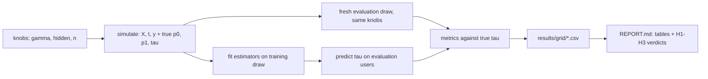

# Causal Uplift

> How far do uplift estimators fall from a known true treatment effect as confounding rises?

[](https://github.com/Prithv122/causal-uplift/actions/workflows/ci.yml)

**Live demo:** not deployed — a command-line experiment that runs locally
**Stack:** Python 3.12, numpy, pandas, scikit-learn, LightGBM; EconML as an optional reference arm

---

## 1. The problem

A retention team has a discount budget. Sending it to the users most likely to convert wastes
it on people who would have converted anyway; it should go to users whose conversion the offer
actually *changes*. That is a causal question, and the logs it has to be answered from are not
randomised: the team already sent more offers to engaged users, so a plain comparison of offered
and not-offered users mixes the offer's effect with who got it.

This repo measures how wrong the usual answers are. It simulates users whose true individual
effect is known exactly, then scores each estimator against that truth as the targeting bias
grows from none (a randomised test) to strong.

## 2. The data

| | |
|---|---|
| Source | Own simulator (`src/causal_uplift/dgp.py`), seeded, specified in `DESIGN.md` |
| Size | 10,000 training + 20,000 evaluation users per replication, 200 replications per setting |
| Licence | Code, MIT |
| Real-data check | Criteo Uplift (randomised, 13,979,592 rows, CC BY-NC-SA 4.0), downloaded by a command, never committed |

**The headline numbers are on synthetic data.** That is the point: only a simulation knows each
user's true effect, so only a simulation can say how far an estimate is from it. Real randomised
data has no per-user truth and gets an outcome-only Qini check.

Four planted segments: persuadables (the offer helps), sure things (they convert anyway), lost
causes (nothing helps) and sleeping dogs (the offer hurts).

## 3. Architecture



## 4. Key decisions & tradeoffs

| Decision | Chose | Over | Why |
|---|---|---|---|
| Ground truth | Own simulator with exact per-user `tau` | Only a real dataset | No real dataset has individual effects; without them PEHE and true-Qini cannot be computed |
| Learners | Own S/T/X/DR implementations on LightGBM | EconML as the primary arm | Every step is explainable and testable here; EconML's causal forest stays as a reference arm |
| Evaluation sample | Fresh draw of 20,000 users per replication | Scoring on the training users | Ranking metrics on training users reward overfitting |
| Ranking metric | Qini against the true effect, normalised by the oracle | Outcome-based Qini only | Under confounding the outcome-based Qini is itself biased |
| Reproducibility | `SeedSequence([seed, cell, rep])`, LightGBM single-threaded and deterministic | One global RNG | A row's numbers do not depend on worker count or run order |

## 5. Results

_Not run yet. The grid and the hypotheses are fixed in `PREREGISTRATION.md` before the run; this
section is written from `results/REPORT.md` afterwards._

## 6. How to run

```bash
git clone https://github.com/Prithv122/causal-uplift.git
cd causal-uplift
uv sync
uv run pytest
uv run causal-uplift simulate --n 2000 --seed 1
uv run causal-uplift run-grid --smoke --out results-smoke
uv run causal-uplift report --results results-smoke
```

## 7. What I'd change at 100× scale

_After the run._

---

## References

- Künzel, Sekhon, Bickel, Yu (2019). Metalearners for estimating heterogeneous treatment effects
  using machine learning. PNAS.
- Kennedy (2023). Towards optimal doubly robust estimation of heterogeneous causal effects.
  Electronic Journal of Statistics.
- Radcliffe (2007). Using control groups to target on predicted lift. (Qini curve.)
- Diemert, Betlei, Renaudin, Amini (2018). A large scale benchmark for uplift modeling.
  (Criteo Uplift dataset.)
